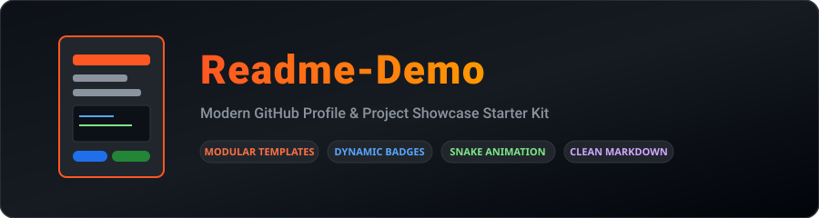

<div align="center">



# Readme-Demo

**A modular, curated GitHub Profile & Project Showcase starter kit engineered with modern Markdown components, dynamic SVG badges, and automated contribution graph workflows.**

[](LICENSE)
[](https://docs.github.com/en/get-started/writing-on-github)
[](.github/workflows/snake-profile.yml)

[Templates Directory](templates/) · [Customization Guide](#-step-by-step-customization-guide) · [Component Catalog](#-reusable-component-catalog) · [Automations](#-contribution-snake-automation)

</div>

---

## 📖 Overview

**`Readme-Demo`** is a reusable documentation foundation and profile showcase system. It provides developers, AI/ML engineers, and open-source creators with clean, pre-configured Markdown layouts that stand out to technical recruiters and collaborators without cluttered visual bloat or broken formatting.

Included inside this repository are ready-to-use template files:
- 📄 [`templates/PROFILE_TEMPLATE.md`](templates/PROFILE_TEMPLATE.md) — Production developer profile README with dynamic typing, responsive project tables, skill icons, and live statistics.
- ⚙️ [`.github/workflows/snake-profile.yml`](.github/workflows/snake-profile.yml) — Automated GitHub Action to generate and publish an animated GitHub contribution snake SVG.

---

## 🛠️ Step-by-Step Customization Guide

Follow this simple 5-step checklist to adapt this template for your own GitHub profile:

1. **Create Special Profile Repo:**  
   Create a new public repository with the exact same name as your GitHub username (e.g. `https://github.com/<your-username>/<your-username>`).

2. **Copy Template:**  
   Copy the contents of [`templates/PROFILE_TEMPLATE.md`](templates/PROFILE_TEMPLATE.md) into the `README.md` of your profile repository.

3. **Replace Placeholders:**  
   Search and replace the template tokens:
   - `{{YOUR_GITHUB_USERNAME}}` → Your GitHub account handle
   - `{{YOUR_NAME}}` → Your display name
   - `{{YOUR_TITLE}}` → Primary specialization (e.g. `AI/ML Engineer | Distributed Systems`)
   - `{{YOUR_PROJECTS}}` → Your top flagship repositories

4. **Enable Actions Workflow (Optional):**  
   Copy [`.github/workflows/snake-profile.yml`](.github/workflows/snake-profile.yml) into your profile repository under `.github/workflows/`.  
   In your repository **Settings → Actions → General → Workflow permissions**, ensure **"Read and write permissions"** is selected.

5. **Commit and Publish:**  
   Push changes to your `main` branch. Your GitHub profile page will immediately render your new, elevated personal developer dashboard!

---

## 🎨 Reusable Component Catalog

### 1. Dynamic Typing Banner (SVG)
Generates high-contrast typewriter text without client-side JavaScript:
```markdown

```

### 2. Live Project Views Counter
Displays a clean badge tracking unique page hits:
```markdown

```

### 3. Responsive 2-Column Project Card Grid
Uses GitHub Flavored Markdown `<table>` blocks to format flagship repositories cleanly across desktop and mobile devices:
```html
<table>
<tr>
<td width="50%" valign="top">

### 🌟 Project Alpha
Brief description of the problem solved and core differentiators.  
`Python` `FastAPI` `PyTorch`  
<br>
[](https://github.com/username/project)

</td>
<td width="50%" valign="top">

### ⚡ Project Beta
High-performance distributed backend engine.  
`TypeScript` `React` `Docker`  
<br>
[](https://github.com/username/project)

</td>
</tr>
</table>
```

### 4. Categorized Skill Icons
Uses the CDN-hosted [SkillIcons](https://skillicons.dev/) service to render clean, consistent vector badges:
```markdown

```

---

## 🐍 Contribution Snake Automation

The included workflow [`.github/workflows/snake-profile.yml`](.github/workflows/snake-profile.yml) runs every 12 hours via GitHub Actions:
- Ingests your real public GitHub contribution graph.
- Generates light and dark theme animated SVGs:
  - `dist/kamalesh-contribution-snake.svg`
  - `dist/kamalesh-contribution-snake-dark.svg`
- Commits them automatically to an orphan branch named `output`, ready to embed seamlessly into any Markdown document via raw GitHub user content links.

---

## 📄 License

This starter kit is open-sourced under the [MIT License](LICENSE).
